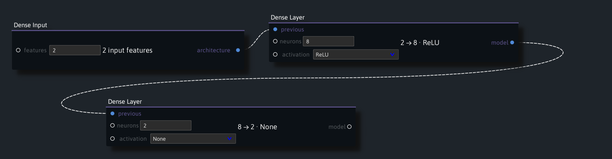

# Visual PyTorch model building in Ryven

Ryven is a visual editor for connecting Python nodes. This Undergraduate Research Opportunity Programme (UROP) project extends earlier Ryven work on Python operations and TensorFlow with a PyTorch layer builder and training-script exporter. Connect a model and a dataset to a training node, then inspect the generated Python. The saved examples include dense classifiers, image classifiers, and a variational autoencoder for reconstructing and generating clothing images.

## Quick start

1. Clone or download this repository and run `bash setup.sh` from its root. Use **Git Bash** on Windows. On Linux, install Python 3.10 with `venv` support first.
2. Run `bash open.sh pytorch/linear_demo.json` to open a classifier for synthetic two-dimensional points.
3. Click **Load Examples** on **Sample Dataset**, then **Train** on **Train Model**. **Test Model** displays the loss and accuracy for 64 held-out points. To run training in Colab, click **Copy Training Code** and paste the script into a cell in a new notebook. The script generates its own training points.

See the [setup instructions](docs/Guide.md#install-and-open-ryven) for supported platforms and [Presets](docs/Presets.md) for the other project files.

## Documentation

| Guide | What you'll find |
|---|---|
| [Project Guide](docs/Guide.md) | Setup, screenshot walkthroughs, architecture, and how to extend the node package. |
| [Presets](docs/Presets.md) | Included Ryven project files and how to open, run, and save them. |
