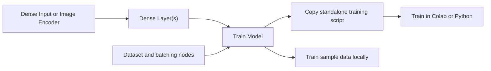

# Project Guide

[Project overview](../README.md) · [Presets](Presets.md)

Ryven passes values between connected nodes on a canvas. In this project, the model nodes pass layer settings to the training node. The training node uses those settings to write the PyTorch model, load the selected dataset, and run training in a standalone script.

- [Install and open Ryven](#install-and-open-ryven)
- [Build a dense classifier](#build-a-dense-classifier)
- [Export and train in Colab](#export-and-train-in-colab)
- [Build a Fashion-MNIST VAE](#build-a-fashion-mnist-vae)
- [Build an image classifier](#build-an-image-classifier)
- [Use image folders in Google Drive](#use-image-folders-in-google-drive)
- [Architecture](#architecture)
- [Change a node or export](#change-a-node-or-export)
- [Run the checks](#run-the-checks)
- [Project origins](#project-origins)

## Install and open Ryven

Run this command from the repository root.

```bash
bash setup.sh
```

- **x64 Windows** — Run the command in Git Bash. Setup installs Python 3.10 for your account if needed.
- **x86-64 Linux** — Install Python 3.10 with `venv` support before running setup.

On both platforms, setup creates or reuses the project's `.venv` and installs its packages. First-time setup needs internet access. When setup finishes, run `bash open.sh` for a blank graph or pass a [preset filepath](Presets.md).

The pinned PySide2 version uses Python 3.10. [Python 3.10 release notes](https://www.python.org/downloads/release/python-31022/)

## Build a dense classifier

1. In the **Nodes** sidebar, search for **Dense Input** and **Dense Layer**, or find them under **Model Setup**.
2. Set **features** to `2` in **Dense Input**. Connect its **architecture** output to **previous** on the first **Dense Layer**.
3. Set the first layer to **8 neurons** and **ReLU**. Connect its **model** output to **previous** on a second **Dense Layer**. Set the second layer to **2 neurons** and **None** so it returns two raw class scores for cross entropy.


## Export and train in Colab

Sign in to [Google Colab](https://colab.research.google.com/), create a Python notebook, and connect to a hosted runtime. The exported script goes in a code cell. Use a CPU runtime to compare with the report's CPU results.

1. Add **Train Model** and connect the last **Dense Layer** to its **model** input.
2. Add **CSV File** and set **csv_path** to `/content/train.csv`. Connect its **dataset** output to **DataLoader**, then connect **dataloader** to **train_data_loader** on **Train Model**. Ryven uses the CSV path without opening the file.
3. Set **batch_size** to `32` and **shuffle** to **True**. In **Train Model**, select **cross_entropy**, **Adam**, a learning rate of `0.001`, and `10` epochs. Click **Copy Training Code**.

   

4. Save the example below as `train.csv`. In Colab, upload it using the **Files** sidebar and check that its path is `/content/train.csv`. Paste the copied script into a new code cell and run it. If you uploaded the file somewhere else, update `DATA_PATH` in that cell before running it.

The exported script uses the batch size and shuffle settings from the **DataLoader** node to create a PyTorch `DataLoader`. It reports loss by epoch and saves `training_result.pth` in the current working directory, normally `/content` in a new notebook. Refresh the **Files** sidebar to find and download the checkpoint before the runtime ends.

Use a header row, numeric feature columns first, and the target column last. For cross entropy, labels are zero-based integers. This small CSV exercises the two-feature, two-class example above.

```csv
x1,x2,label
-1,-1,0
-1,1,0
1,-1,1
1,1,1
```

The exported script loads the CSV into the training machine's memory. The same script can run as a local Python file with PyTorch installed and `DATA_PATH` set to the file location.

For regression or other losses that take numeric targets, use one target column per output neuron.

To try the workflow without a CSV, replace **CSV File** with **Sample Dataset** and connect its **train_dataset** output to **DataLoader**. Select **Linear boundary** and click **Load Examples**. This generates 128 training points and 64 separate test points. Each point has two features, `x1` and `x2`. Points with `x1 > 0` are class 1 and the remaining points are class 0. **XOR quadrants** uses the same features and assigns class 1 when the coordinates have opposite signs.

The generated script includes the data generator and trains on the 128 training points. To evaluate inside Ryven, connect **test_dataset** through a second **DataLoader** to **Test Model**, then connect **trained_model** from **Train Model** and click **Train**. The [linear preset](Presets.md#run-a-preset) already has this wiring.

### Reproduce the hidden-width comparison

Use the two-layer classifier above with **Sample Dataset** set to **Linear boundary**. Keep batch size 32, shuffle **True**, cross entropy, Adam, learning rate 0.001, and 10 epochs for both runs. Click **Copy Training Code** with an 8-neuron hidden layer, then repeat with 16 neurons. In each pasted script, change the `output_checkpoint` entry in `SETTINGS` to a distinct name, such as `width_8.pth` and `width_16.pth`. Run the cells and compare the logged training losses.

## Build a Fashion-MNIST VAE

Open the [Fashion-MNIST VAE preset](Presets.md#what-the-fashion-mnist-vae-learns) to see how the variational autoencoder is wired. It learns to reconstruct clothing images from sampled latent vectors. Connect **Dense Input → Dense Layer(s) → VAE Latent Layer → Dense Layer(s) → Train VAE**. Set the input to 784 features and the final decoder layer to 784 neurons with activation **None**. The script flattens the images before encoding, reshapes the decoder outputs, and computes the reconstruction loss from the raw pixel logits.

Connect **Fashion-MNIST → DataLoader → Train VAE**. Try changing the encoder width or the number of latent dimensions. **Train VAE** controls the learning rate, epochs, and how much the KL divergence contributes to the training loss. Click **Copy Training Code**, then paste and run it in Colab. The script downloads the dataset and writes `fashion_mnist_vae.png` and `fashion_mnist_vae.pth` to the current working directory.

## Build an image classifier

1. Add **Image Encoder** and choose **resnet18**, **resnet34**, **resnet50**, or **mobilenet_v2**. **DEFAULT** weights with **freeze** set to **True** keep the pretrained encoder fixed. Ryven stores these settings in the graph. The generated script creates the encoder and fetches the weights on the training machine.
2. Connect the encoder's **architecture** output to **previous** on a **Dense Layer**. Add as many dense layers as needed. For two classes, try **64 neurons, ReLU → 2 neurons, None**. Connect the last layer's **model** output to **Train Model** and use **cross_entropy**.
3. Connect **Image Folder → DataLoader → Train Model**. Set **image_folder** to a path such as `/content/train` with one subfolder per class. Set the last layer's neuron count to the number of class folders. The digits and weed presets point to the bundled training folders. To run the script elsewhere, upload the preset's `train` folder and update `DATA_PATH`. The sibling `test` folder contains held-out images.
4. Click **Copy Training Code** and run it in Colab with the image folder available. For a dataset kept in Drive, follow the steps below. The script applies the encoder's preprocessing, loads images in batches, and saves the class names with the weights in `training_result.pth`.

The digits images are a subset of the [UCI Optical Recognition of Handwritten Digits dataset](https://archive.ics.uci.edu/dataset/80/optical%2Brecognition%2Bof%2Bhandwritten%2Bdigits) distributed under [CC BY 4.0](https://creativecommons.org/licenses/by/4.0/). The weed photos come from the [DeepWeeds teaching subset](../pytorch/demo_data/deepweeds/README.md).

### Use image folders in Google Drive

The report's Drive example uses the five-class digits preset. It works with a copy of the public repository in your own Google Drive.

1. Download and extract the repository from GitHub. Upload the freshly extracted folder to **My Drive**, keeping the `pytorch/demo_data/digits/train` folder and its five class subfolders intact.
2. Open `pytorch/five_class_demo.json` in Ryven and click **Copy Training Code** on **Train Model**.
3. In a new hosted Colab notebook, run the cell below. When Colab asks, authorize the notebook to mount the Google Drive account you uploaded to. Replace `UROP-Ryven-Pytorch-main` with the exact name of the folder you uploaded.

   ```python
   import os
   from pathlib import Path
   from google.colab import drive

   drive.mount("/content/drive")
   project = Path("/content/drive/MyDrive/UROP-Ryven-Pytorch-main")
   train = project / "pytorch/demo_data/digits/train"
   if not train.is_dir():
       raise FileNotFoundError(f"Check the uploaded folder name and layout: {train}")
   os.chdir(project)
   ```

4. Paste the export into the next code cell. Leave `DATA_PATH = 'pytorch/demo_data/digits/train'` as exported and run the cell. The working directory set above makes that relative path resolve, and `training_result.pth` is saved in the uploaded project folder. To avoid overwriting an earlier run, change the `output_checkpoint` entry in `SETTINGS` before running the cell.

For the weed preset, open `pytorch/weed_demo.json` in step 2, use `pytorch/demo_data/deepweeds/train` in the path check, and keep the weed export's own `DATA_PATH`. [Colab guidance on Drive authorization](https://research.google.com/colaboratory/faq.html)

## Architecture

The launcher uses the workspace's `.venv` and starts Ryven in the repository root so the saved presets can resolve their node package and data paths.



| Component | Responsibility |
|---|---|
| [`open_ryven.py`](../pytorch/open_ryven.py) and [`nodes.py`](../pytorch/nodes/nodes.py) | Launch Ryven and register the project's node types under stable identifiers. |
| [`dense_layers.py`](../pytorch/nodes/dense_layers.py) | Store the input width, optional encoder, and ordered dense layers. Each dense node appends its settings and passes the architecture downstream. |
| [`torch_utils_data.py`](../pytorch/nodes/torch_utils_data.py) and [`learning_samples.py`](../pytorch/nodes/learning_samples.py) | Create local sample batches or pass the remote dataset path and batching settings to the exporter. |
| [`train_model.py`](../pytorch/nodes/train_model.py) and [`training_export.py`](../pytorch/nodes/training_export.py) | Validate the graph inputs and use the same training loop for local samples and standalone scripts. The exporter renders the layer definitions and data-loading code. |
| [`vae.py`](../pytorch/nodes/vae.py) and [`vae_export.py`](../pytorch/nodes/vae_export.py) | Connect the encoder and decoder through a variational latent layer and export Fashion-MNIST training and image previews. |
| [`gui.py`](../pytorch/nodes/gui.py) and [`test_model.py`](../pytorch/nodes/test_model.py) | Provide the node controls and clipboard action, run local training in a Qt worker, and score a trained model on held-out local batches. |

The image encoder is a configuration value while the graph is open. The exported script constructs the selected torchvision model, replaces its classifier with an identity layer, and appends the user's dense layers. A frozen encoder stays in evaluation mode during training so its batch-normalization statistics stay fixed.

## Change a node or export

1. Define the node's inputs, outputs, and validation in its Python module. Register a new node in `nodes.py` and add its editable controls in `gui.py`.
2. For a new exportable layer, update the architecture representation, local model construction where applicable, and the generated code. Check that output widths and activation settings agree in both paths.
3. Check that graph settings survive save and reopen, then verify that the copied script executes outside Ryven.

## Run the checks

Run these commands from the repository root in PowerShell.

```powershell
& .venv/Scripts/python.exe -m unittest discover -s pytorch/tests -v
& .venv/Scripts/python.exe pytorch/tests/gui_smoke.py
```

The integration tests exercise local linear training and held-out scoring, and run the CSV, image-classifier, and VAE exports on small test datasets. The image-classifier check uses two generated images and substitutes an encoder without pretrained weights so it can run offline. The VAE check uses four generated training images and two test images in Fashion-MNIST format and verifies the checkpoint and preview. The Qt smoke test opens all four presets and checks that each can copy training code.

## Project origins

This project follows earlier UROP work on [Ryven nodes for Python operations](https://github.com/Leong-ZM/UROP_Ryven_2025) and [Ryven nodes for TensorFlow](https://github.com/Chiang-HuiXin/Ryven_TF). The earlier TensorFlow nodes pass tensors and Python snippets between nodes. This project passes layer and dataset settings and generates the training script at the training node. The `float_spinbox` helper in [`gui.py`](../pytorch/nodes/gui.py) adapts the earlier TensorFlow project's widget.
