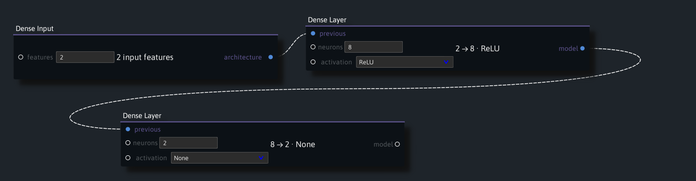
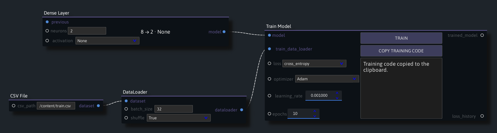
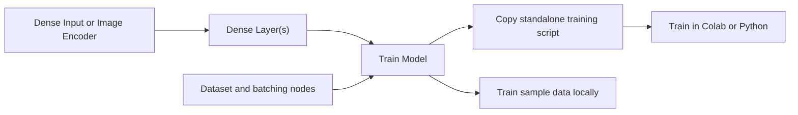

# Project Guide

[Project overview](../README.md) · [Presets](Presets.md)

Use Ryven to build a PyTorch model from connected layers and export the training code to Colab or another Python environment.

- [Install and open Ryven](#install-and-open-ryven)
- [Build a dense classifier](#build-a-dense-classifier)
- [Export and train in Colab](#export-and-train-in-colab)
- [Build a Fashion-MNIST VAE](#build-a-fashion-mnist-vae)
- [Build an image classifier](#build-an-image-classifier)
- [Architecture](#architecture)
- [Change a node or export](#change-a-node-or-export)
- [Run the checks](#run-the-checks)

## Install and open Ryven

Run this command from the repository root.

```bash
bash setup.sh
```

- **x64 Windows** — Run the command in Git Bash. Setup installs Python 3.10 for your account if needed.
- **x86-64 Linux** — Install Python 3.10 with `venv` support before running setup.

On both platforms, setup creates or reuses the project's `.venv` and installs its packages. First-time setup needs internet access. When setup finishes, run `bash open.sh` for a blank graph or pass a [preset filepath](Presets.md).

The pinned PySide2 version uses Python 3.10. [Python 3.10 release notes](https://www.python.org/downloads/release/python-31022/)

## Build a dense classifier

1. In the **Nodes** sidebar, search for **Dense Input** and **Dense Layer**, or find them under **Model Setup**.
2. Set **features** to `2` in **Dense Input**. Connect its **architecture** output to **previous** on the first **Dense Layer**.
3. Set the first layer to **8 neurons** and **ReLU**. Connect its **model** output to **previous** on a second **Dense Layer**. Set the second layer to **2 neurons** and **None** so it returns two raw class scores for cross entropy.



## Export and train in Colab

1. Add **Train Model** and connect the last **Dense Layer** to its **model** input.
2. Add **CSV File** and set **csv_path** to `/content/train.csv`. Connect its **dataset** output to **DataLoader**, then connect **dataloader** to **train_data_loader** on **Train Model**. Ryven uses the CSV path without opening the file.
3. Set **batch_size** to `32` and **shuffle** to **True**. In **Train Model**, select **cross_entropy**, **Adam**, a learning rate of `0.001`, and `10` epochs. Click **Copy Training Code**.

   

4. In Colab, upload `train.csv` to `/content`, paste the copied code into a cell, and run it. You can change `DATA_PATH` in the script if the file is somewhere else. The script loads the data on the training machine, uses CUDA when available, reports loss by epoch, and writes `training_result.pth`.

The exported script uses the batch size and shuffle settings from the **DataLoader** node to create a PyTorch `DataLoader`.

Use a header row, numeric feature columns first, and the target column last. For cross entropy, labels are zero-based integers. This small CSV exercises the two-feature, two-class example above.

```csv
x1,x2,label
-1,-1,0
-1,1,0
1,-1,1
1,1,1
```

The exported script loads the CSV into the training machine's memory. The same script can run as a local Python file with PyTorch installed and `DATA_PATH` set to the file location.

For regression or other losses that take numeric targets, use one target column per output neuron.

To try the workflow with bundled data, replace the CSV node with **Sample Dataset**, then choose **Linear boundary** or **XOR quadrants**. Click **Load Examples** before exporting. The generated script includes the data generator. You can also click **Train** in Ryven. The linear preset connects a separate test split to **Test Model**.

## Build a Fashion-MNIST VAE

Open the [Fashion-MNIST VAE preset](Presets.md#what-the-fashion-mnist-vae-learns) to see the wiring. Connect **Dense Input → Dense Layer(s) → VAE Latent Layer → Dense Layer(s) → Train VAE**. Set the input to 784 features and the final decoder layer to 784 neurons with activation **None**. The script flattens the images before encoding, reshapes the decoder outputs, and computes the reconstruction loss from the raw pixel logits.

Connect **Fashion-MNIST → DataLoader → Train VAE**. Try changing the encoder width or the number of latent dimensions. **Train VAE** controls the learning rate, epochs, and how much the KL divergence contributes to the training loss. Click **Copy Training Code** and run it in Colab.

## Build an image classifier

1. Add **Image Encoder** and choose **resnet18**, **resnet34**, **resnet50**, or **mobilenet_v2**. **DEFAULT** weights with **freeze** set to **True** keep the pretrained encoder fixed. Ryven stores these settings in the graph. The generated script creates the encoder and fetches the weights on the training machine.
2. Connect the encoder's **architecture** output to **previous** on a **Dense Layer**. Add as many dense layers as needed. For two classes, try **64 neurons, ReLU → 2 neurons, None**. Connect the last layer's **model** output to **Train Model** and use **cross_entropy**.
3. Connect **Image Folder → DataLoader → Train Model**. Set **image_folder** to a path such as `/content/train` with one subfolder per class. Set the last layer's neuron count to the number of class folders. The digits and weed presets point to the bundled training folders. To run the script elsewhere, upload the preset's `train` folder and update `DATA_PATH`. The sibling `test` folder contains held-out images.
4. Click **Copy Training Code** and run it in Colab with the image folder available. The script applies the encoder's preprocessing, loads images in batches, and saves the class names with the weights in `training_result.pth`.

The digits images are a subset of the [UCI Optical Recognition of Handwritten Digits dataset](https://archive.ics.uci.edu/dataset/80/optical%2Brecognition%2Bof%2Bhandwritten%2Bdigits) distributed under [CC BY 4.0](https://creativecommons.org/licenses/by/4.0/). The weed photos come from the [DeepWeeds teaching subset](../pytorch/demo_data/deepweeds/README.md).

## Architecture

The launcher uses the workspace's `.venv` and starts Ryven in the repository root so the saved presets can resolve their node package and data paths.



| Component | Responsibility |
|---|---|
| [`open_ryven.py`](../pytorch/open_ryven.py) and [`nodes.py`](../pytorch/nodes/nodes.py) | Launch Ryven and register the project's node types under stable identifiers. |
| [`dense_layers.py`](../pytorch/nodes/dense_layers.py) | Store the input width, optional encoder, and ordered dense layers. Each dense node appends its settings and passes the architecture downstream. |
| [`torch_utils_data.py`](../pytorch/nodes/torch_utils_data.py) and [`learning_samples.py`](../pytorch/nodes/learning_samples.py) | Create local sample batches or pass the remote dataset path and batching settings to the exporter. |
| [`train_model.py`](../pytorch/nodes/train_model.py) and [`training_export.py`](../pytorch/nodes/training_export.py) | Validate the graph inputs and use the same training loop for local samples and standalone scripts. The exporter renders the layer definitions and data-loading code. |
| [`vae.py`](../pytorch/nodes/vae.py) and [`vae_export.py`](../pytorch/nodes/vae_export.py) | Connect the encoder and decoder through a variational latent layer and export Fashion-MNIST training and image previews. |
| [`gui.py`](../pytorch/nodes/gui.py) and [`test_model.py`](../pytorch/nodes/test_model.py) | Provide the node controls and clipboard action, run local training in a Qt worker, and score a trained model on held-out local batches. |

The image encoder is a configuration value while the graph is open. The exported script constructs the selected torchvision model, replaces its classifier with an identity layer, and appends the user's dense layers. A frozen encoder stays in evaluation mode during training so its batch-normalization statistics stay fixed.

## Change a node or export

1. Define the node's inputs, outputs, and validation in its Python module. Register a new node in `nodes.py` and add its editable controls in `gui.py`.
2. For a new exportable layer, update the architecture representation, local model construction where applicable, and the generated code. Check that output widths and activation settings agree in both paths.
3. Check that graph settings survive save and reopen, then verify that the copied script executes outside Ryven.

## Run the checks

Run these commands from the repository root in PowerShell.

```powershell
& .venv/Scripts/python.exe -m unittest discover -s pytorch/tests -v
& .venv/Scripts/python.exe pytorch/tests/gui_smoke.py
```

The integration tests cover graph reload, data batching, training, checkpoint export, and held-out scoring. The Qt smoke test opens all four presets and checks that each can copy training code.

The guide structure draws on the CS2103/T team-project sample. [AddressBook Level 3 Developer Guide](https://se-education.org/addressbook-level3/DeveloperGuide.html)
